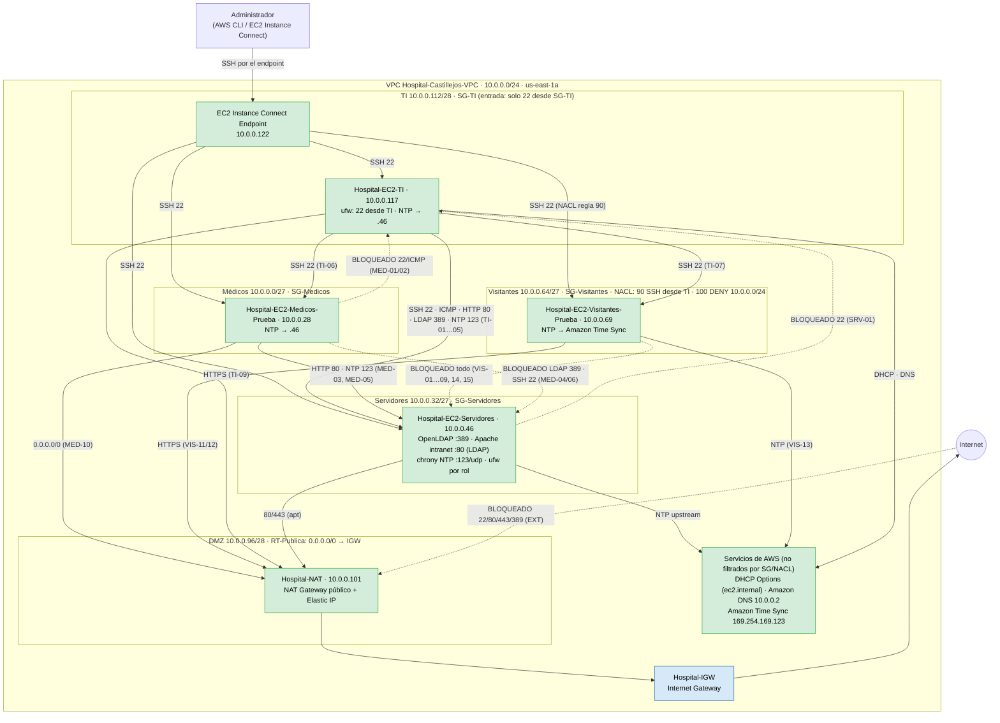

# Diagrama E10.1 — Hospital Privado Castillejos (Fase 3)

Estado al **29/10/2026**, según la configuración real de AWS y las pruebas de `tests_fase3.sh`
(40 PASS / 0 FAIL; ver `fase3/evidencias/INDICE-EVIDENCIAS.md`).
- verde = **probado en AWS**
- azul = **configurado** (sin prueba propia)
- flechas punteadas = tráfico **bloqueado**, comprobado con la prueba indicada

Para exportarlo: pegar el bloque en https://mermaid.live → PNG/SVG, o verlo en GitHub/Obsidian.

## Leyenda de estado (29/10)

| Elemento | Estado | Evidencia |
|---|---|---|
| VPC, 5 subredes, rutas pública y privada, IGW, NAT Gateway | **probado** (salida HTTPS 200 desde TI, Médicos y Visitantes) | `E4.5_estado-previo-rutas.json`, `E7.1_nat-gateway.json`, CSV E8 |
| DHCP de AWS en las 4 EC2 | **probado** | `E5.2_*` |
| NTP: chrony en .46 con Time Sync; TI/Médicos → .46; Visitantes → Time Sync | **probado** | `E5.3_*`, `E5.2_E5.4_*`, TI-04, MED-05, VIS-13 |
| OpenLDAP en .46 (escucha en todas las interfaces; 389 solo Servidores/TI) | **probado** | `probar-ldap.sh` 4/4, TI-03, MED-04, VIS-04 |
| Intranet Apache + LDAP (`Require ip` + `ldap-group`) | **probado** | E6.2 7/7, TI-02, SRV-02, MED-03/08/09, VIS-02/14 |
| SG-Servidores, SG-Medicos, SG-Visitantes, NACL regla 90 | **probado** | `E7.2_*`, CSV E8 |
| Hardening (ufw por rol, SSH sin contraseña ni root) en las 4 EC2 | **probado** | `aws/<equipo>/hardening-*`, `E7.5_*` |
| DMZ con EC2 propia (web pública de Fase 1) | **no implementada** (fuera de alcance; DMZ-01…03 OMITIDAS) | — |

> Lo del Lab 5 (DNS propio, correo, FTP) corrió en VMs locales y **no** forma parte de AWS.
