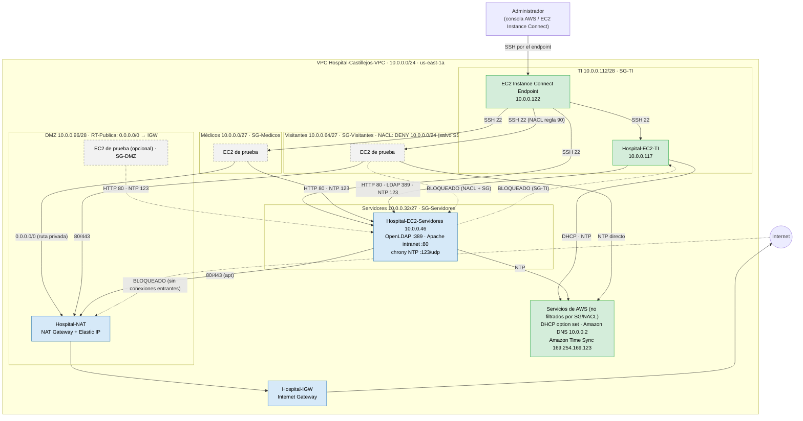

# Diagrama E10.1 — Hospital Privado Castillejos (Fase 3)

Estado al **28/10/2026**, según el informe en curso. Actualizar los colores a medida que Majo configure
y Roberto pruebe:
- verde = **probado**
- azul = **configurado**
- gris punteado = **propuesto**

Para exportarlo: pegar el bloque en https://mermaid.live → PNG/SVG, o verlo en GitHub.

## Leyenda de estado (28/10)

| Elemento | Estado | Evidencia |
|---|---|---|
| VPC, 5 subredes, tablas de rutas, SG-TI, NACL Visitantes, endpoint | configurado | Capturas de Fase 2 y estado inicial de Fase 3 |
| SSH e ICMP TI → Servidores; TCP 22 Servidores → TI bloqueado | **probado** | Fase 2 |
| **DHCP de AWS** en TI (`10.0.0.117/28`, gateway `.113`, DNS `10.0.0.2`, `ec2.internal`) | **probado** | Informe Fase 3 (salida de `ip`, `resolvectl` y lease) |
| **chrony en TI con Amazon Time Sync** (`^*` 169.254.169.123) | **probado** | Informe Fase 3 (`chronyc tracking/sources`) |
| Hospital-IGW + `0.0.0.0/0 → IGW` (RT-Publica) | configurado | Informe Fase 3 |
| Hospital-NAT (NAT Gateway) + `0.0.0.0/0 → NAT` (RT-Privada) | configurado (falta la captura de `curl` desde TI y Servidores) | Informe Fase 3 |
| SG-Servidores salida 80/443 | configurado | Informe Fase 3 |
| slapd en `10.0.0.46` (a mano; solo `127.0.0.1`) | configurado parcialmente: pendientes los Pasos 2b/2c de REGLAS | Informe Fase 3 |
| Entradas de SG-Servidores (80/389/123), SG-Medicos/Visitantes/DMZ, NACL regla 90, EC2 de prueba | propuesto | REGLAS-E4.4 |
| Intranet y NTP servidor en `10.0.0.46` | propuesto en AWS (intranet probada en VM local, 9/9) | `fase3/isabella`, `fase3/leonardo` |

> Lo del Lab 5 (DNS propio, correo, FTP) corrió en VMs locales y **no** forma parte de AWS.
