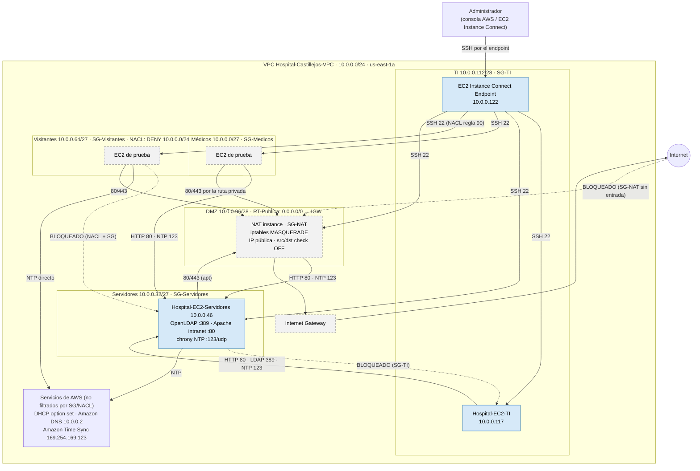

# Diagrama E10.1 — Hospital Privado Castillejos (Fase 3)

Estado al **28/10/2026**. Actualizar los colores a medida que Majo configure y Roberto pruebe:
- verde = **probado**
- azul = **configurado**
- gris punteado = **propuesto**

Para exportarlo: pegar el bloque en https://mermaid.live → PNG/SVG, o verlo en GitHub.

## Leyenda de estado (28/10)

| Elemento | Estado | Evidencia |
|---|---|---|
| VPC, 5 subredes, 2 tablas de rutas (solo local) | configurado | Capturas de Fase 2 |
| EC2 TI y Servidores, endpoint, SG-TI, SG-Servidores (22/ICMP), NACL Visitantes | configurado | Capturas de Fase 2 |
| SSH e ICMP TI → Servidores; TCP 22 Servidores → TI bloqueado | **probado** | Fase 2 |
| IGW, NAT instance, rutas `0.0.0.0/0`, SG-NAT/Medicos/Visitantes, reglas nuevas de SG-Servidores, NACL regla 90 | propuesto | REGLAS-E4.4 |
| LDAP, intranet, NTP en `10.0.0.46` | propuesto (probado en VM local, **no** en AWS) | `fase3/sebastian`, `fase3/leonardo` |
| DHCP de AWS | configurado (por defecto) | Roberto E5.1/E5.2 |

> Lo del Lab 5 (DNS propio, correo, FTP) corrió en VMs locales y **no** forma parte de AWS.
