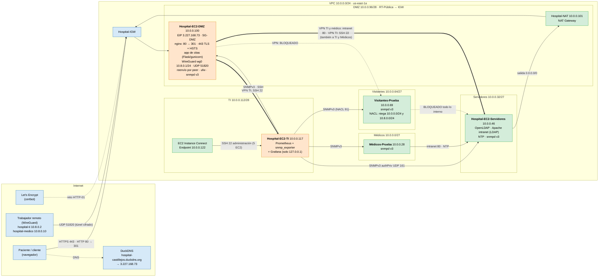

# Diagrama — Hospital Privado Castillejos (Fase 4)

Estado al **08/11/2026**, según la configuración real de AWS y las pruebas de la Fase 4
(ver `fase4/evidencias/INDICE-EVIDENCIAS.md`).
- verde = **probado en AWS** (Fase 3, sigue pasando la regresión) · naranja = **nuevo en Fase 4, probado** · azul = externo / AWS administrado
- flechas gruesas = tráfico de la VPN · punteadas = **bloqueado** (comprobado) o auxiliar (DNS, ACME)
- Rutas: RT-Privada (Médicos, Servidores, Visitantes, TI) → 0.0.0.0/0 NAT y **10.8.0.0/24 → ENI de la DMZ** (retorno de la VPN sin NAT). Todas las subredes privadas salen por el NAT; en el dibujo solo se muestra una flecha.

PNG exportados con mermaid-cli: `fase4/DIAGRAMA-F4.png` (horizontal, para diapositivas) y `fase4/DIAGRAMA-F4-vertical.png` (para el informe), desde `DIAGRAMA-F4.mmd` y `DIAGRAMA-F4-vertical.mmd`.

## Componentes nuevos de la Fase 4

| Componente | Dónde | Estado | Evidencia |
|---|---|---|---|
| DMZ con EC2 propia (`Hospital-EC2-DMZ`, EIP 3.227.168.73, SG-DMZ) | 10.0.0.100 | **probado** | `F4.1_*`, `F4.5_*` |
| Web pública de citas con dominio `hospital-castillejos.duckdns.org` | DMZ (nginx + Flask/gunicorn + SQLite) | **probado** (crear/consultar cita) | `F4.2_pruebas-web-laptop.txt` |
| TLS Let's Encrypt, solo HTTPS, HTTP → 301, HSTS, renovación automática | DMZ | **probado** (`renew --dry-run` OK) | `F4.2_certbot-y-renovacion.txt` |
| VPN WireGuard con reglas por peer, sin NAT (ruta 10.8.0.0/24 → ENI DMZ) | DMZ + RT-Privada | **probado** (TI 12/12, médico 9/9) | `F4.3_*`, `F4.5_post-hardening-dmz.txt` |
| SNMPv3 authPriv (sin v1/v2c) en las 5 EC2 | todas | **probado** (5/5; v2c y clave incorrecta rechazados) | `F4.4_pruebas-snmp-desde-ti.csv`, `F4.4_sonda-snmp-alcance.csv` |
| Prometheus + snmp_exporter + Grafana (extra 10 %), solo TI | TI 127.0.0.1 | **probado** (dashboard con 5 equipos) | `F4.4_grafana-dashboard.png` |
| Firewall adaptado (SG, NACL 91, ufw en las 5 EC2, hardening DMZ) | todas | **probado** (regresión 32/32) | `F4.6_regresion-fase3-5-origenes.csv` |

> El acceso a Grafana es solo para TI: túnel SSH `-L 3000` por el EC2 Instance Connect Endpoint o desde el peer VPN `hospital-ti`.
